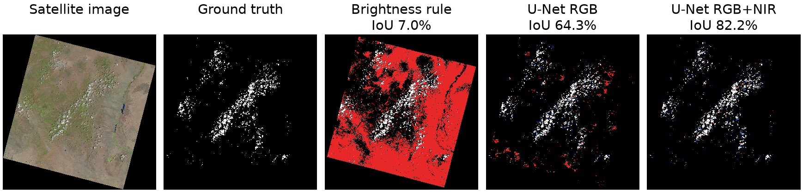

# Cloud segmentation in Landsat 8 images

A U-Net with an ImageNet-pre-trained ResNet34 encoder that marks cloud pixels in satellite images, trained and tested on the [38-Cloud](https://github.com/SorourMo/38-Cloud-A-Cloud-Segmentation-Dataset) dataset.



## Results (20 full test scenes, official 38-Cloud evaluation)

| Method | Precision | Recall | Specificity | IoU | Accuracy |
|---|:---:|:---:|:---:|:---:|:---:|
| Brightness threshold (baseline) | 61.6 | 85.5 | 83.8 | 53.3 | 82.5 |
| U-Net, RGB | 90.5 | 89.3 | 97.4 | 81.4 | 96.2 |
| U-Net, RGB + NIR | **93.6** | 85.8 | **98.5** | **81.5** | **96.5** |
| Cloud-Net (published) | | | | 78.5 | |

- Both U-Nets reach about 81% IoU, above the published Cloud-Net (78.5%), which suggests ImageNet pre-training helps.
- Adding the near-infrared band gives fewer false clouds over bright ground (higher precision) and improved IoU in 11 of 20 scenes. The average gain is small, because one scene with only 0.13% cloud pixels was almost entirely missed.

## How it works

- **Data:** 384×384 patches of four Landsat 8 bands (red, green, blue, near-infrared). Empty border patches are dropped. Validation holds out whole scenes, so the model is checked on places it has never seen.
- **Model:** `segmentation_models_pytorch` U-Net, ResNet34 encoder, Dice loss, random 90° rotations and flips.
- **Evaluation:** patch predictions are stitched into full scenes, the padding is cropped, and the metrics are averaged over the 20 test scenes, following the dataset authors' `evaluation.m`.

## Run it

```bash
pip install torch segmentation-models-pytorch tifffile numpy matplotlib tqdm
# download 38-Cloud into data/ (38-Cloud_training, 38-Cloud_test)
python build_cache.py                    # one-time: pack training patches into memory-mapped arrays
python train.py --bands rgbn --epochs 20 # or --bands rgb
python evaluate.py                       # all runs in runs/ + the baseline
python make_figures.py
```

| File | What it does |
|---|---|
| `data.py` | Loads and stacks the band patches; scene-wise train/validation split |
| `build_cache.py` | Packs the training patches into fast memory-mapped `.npy` files |
| `train.py` | Trains the U-Net and logs validation IoU per epoch |
| `evaluate.py` | Full-scene evaluation of the models and the brightness baseline |
| `make_figures.py`, `summarize.py`, `explore.py` | Figures, result table, data exploration |

Course project for *CS & AI Working Life*, LUT University, 2026.
